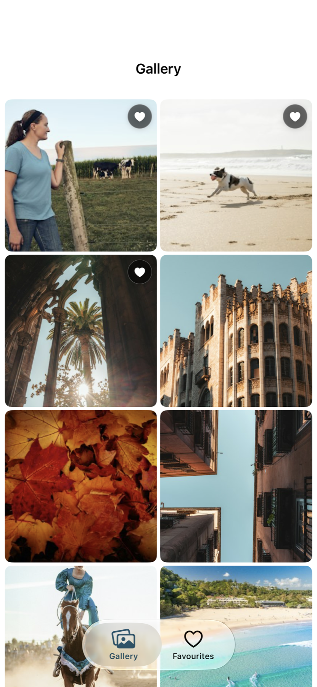
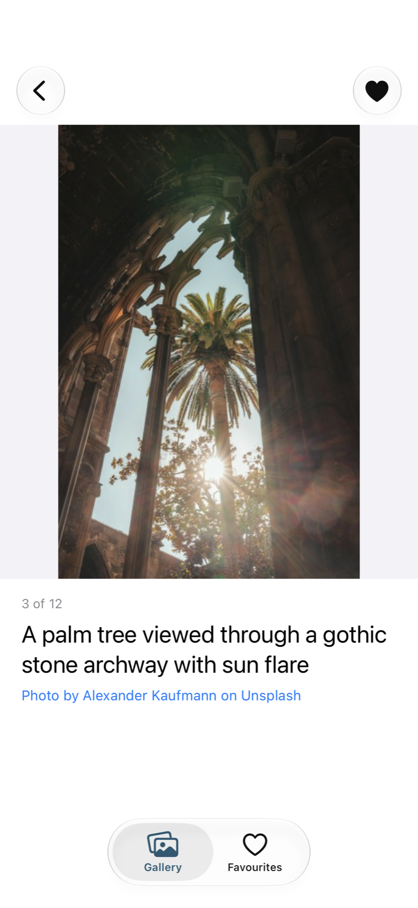
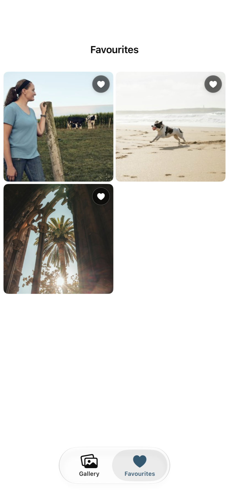
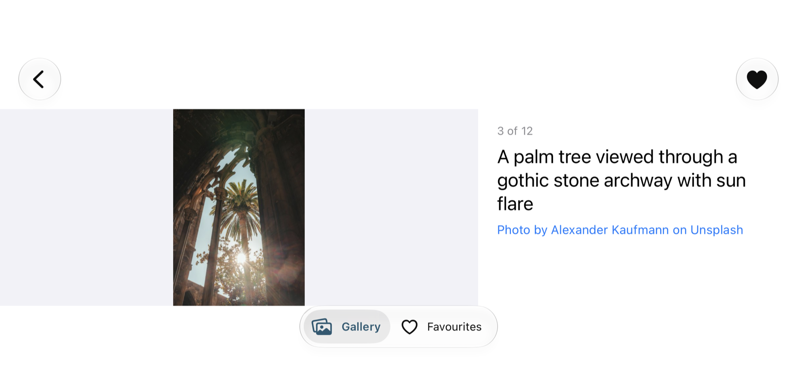

# GalleryApp

An iOS photo gallery built on the Unsplash API: browse a paginated grid, open a photo to read
its details and swipe through the set, and keep a locally persisted list of favourites.

- **Repository:** [github.com/kirillpukhov2004/GalleryApp](https://github.com/kirillpukhov2004/GalleryApp)
- **Platform:** iOS 17+, iPhone and iPad
- **Stack:** Swift 6, UIKit, Combine, Core Data, URLSession, XCTest
- **Dependencies:** none

## Contact

- **Author:** Kirill Pukhov
- **GitHub:** [@kirillpukhov2004](https://github.com/kirillpukhov2004)
- **Repository:** [kirillpukhov2004/GalleryApp](https://github.com/kirillpukhov2004/GalleryApp)

## Overview

GalleryApp is a UIKit application written in Swift for iOS 17 and above. It fetches curated
photos from Unsplash 30 at a time, caches thumbnails for smooth scrolling, and stores
favourites locally with Core Data. State is carried reactively with Combine, and navigation
is handled by coordinators so view controllers stay free of routing logic.

The app has three screens:

1. **Gallery** — an adaptive grid of Unsplash thumbnails with infinite scroll, pull to
   refresh, a favourite badge on favourited photos, and loading, empty and error states.
2. **Detail** — a larger image with title, description and photographer attribution, a heart
   toggle, and horizontal swiping through the photos already loaded by the gallery.
3. **Favourites** — the favourited photos in a grid, with removal, persisted across launches.

## Screenshots

| Gallery | Detail | Favourites |
| --- | --- | --- |
|  |  |  |

Detail in landscape uses a split layout: the image on the left, the scrollable metadata
column on the right.



Screenshots were captured from the app running in the iPhone 17 simulator.

## Key functionality

- **Paginated gallery** — 30 photos per request, the next page loads as the user approaches
  the bottom, and pagination stops when Unsplash returns a short page. Pull to refresh
  replaces the set without losing the loaded favourites.
- **Favourite badge on thumbnails** — a high-contrast heart badge appears immediately when a
  photo is favourited and stays in sync while scrolling, without reloading the grid.
- **Swipeable detail** — horizontal paging through the loaded set, with title, description,
  page position and a link to the photographer's Unsplash profile. The current page is
  preserved through rotation.
- **Persistent favourites** — Core Data stores photo metadata with a unique `photoID`, so
  favourites survive relaunches and can never be duplicated. Image files are never stored.
- **One source of truth** — the gallery badge, the detail heart and the favourites grid all
  subscribe to the same repository publisher, so they cannot disagree.
- **Resilient UI** — typed network errors are mapped to user-facing states with retry
  actions; a missing access key shows a configuration screen instead of crashing.
- **Adaptive and accessible** — size-class-driven grid, a dedicated landscape detail layout,
  Dynamic Type, dark mode, VoiceOver labels and a custom action for removing favourites.

## Assumptions and additional features

- The app uses Unsplash **public authentication** (`Authorization: Client-ID <access key>`).
  No user login or OAuth flow is implemented because the assignment only needs read access.
- The demo API limit is **50 requests per hour**. Pages are fetched once, images are cached,
  and retries are user-driven, so normal browsing stays inside that budget.
- Favourites store **metadata only** — id, title, description, URLs, photographer, size.
- Image URLs returned by the API are hotlinked directly and the `ixid` parameter is preserved,
  as required by the Unsplash API guidelines. Detail credits the photographer with a link.
- Beyond the brief: adaptive iPhone/iPad grid, landscape split detail layout, non-blocking
  pagination retry, VoiceOver custom actions, a configuration error screen, an app icon, and
  unit tests for the layout behaviour as well as the view models.
- **No third-party packages.** XcodeGen and SwiftLint are development tools only.

## Solutions overview

### Architecture

```
App            AppDelegate, SceneDelegate, AppCoordinator, AppDependencies
Presentation   ViewController + ViewModel per screen, coordinators
Domain         Photo, PhotoFetching, FavouritesRepositoryProtocol
Data           UnsplashClient + DTOs, Core Data stack and repository
Core           HTTPClient, APIError, ImageLoader, AppConfiguration, design system
```

- **MVVM** — each screen has a `@MainActor` view model exposing `@Published` state; view
  controllers render and forward events only.
- **Coordinator** — `AppCoordinator` owns the tab bar; `GalleryCoordinator` and
  `FavouritesCoordinator` own their navigation stacks and build detail screens.
- **Dependency injection** — every collaborator is a protocol injected through initialisers.
  `AppDependencies.live()` is the only place that assembles concrete types, and it is called
  from `SceneDelegate`.
- **Programme to protocols** — `HTTPClient`, `PhotoFetching`, `ImageLoading` and
  `FavouritesRepositoryProtocol` keep the layers replaceable and testable.

### Patterns

- **Observer** — Combine publishers carry state from repositories and use cases to view models.
- **Delegate** — collection view data source/delegate and image-loading completion.
- **Factory** — coordinators and the dependency container build view controllers and view models.
- **Dependency inversion** — high-level view models never reference URLSession or Core Data types.
- **Singleton avoided** — the Core Data stack and image loader are created once in the
  composition root and injected; no feature code reaches for `.shared`.

### SOLID

- **Single responsibility** — decoding in the data layer, formatting and state in view
  models, rendering in view controllers.
- **Open/closed** — new photo sources or endpoints implement the existing protocols.
- **Liskov substitution** — every test double is a drop-in for its protocol.
- **Interface segregation** — small protocols (`ImageLoading`, `PhotoFetching`) instead of one
  broad service.
- **Dependency inversion** — abstractions at the boundaries, concrete types only at the root.

### Concurrency

The project uses **Swift 6 strict concurrency**. Domain models and DTOs are `Sendable`,
view models are main-actor isolated, Core Data writes run on background contexts, and the
image loader guards its cache with a lock while exposing an async API. Cancelling a cell's
task stops the consumer without throwing away an image another cell is waiting for.

### Why these choices

- **MVVM + coordinators** keeps UIKit lifecycle code thin and makes navigation centralised.
- **Protocol boundaries** let the whole app run in tests with stubs and an in-memory store.
- **Core Data with a unique `photoID`** keeps favourites consistent and scales beyond a
  `UserDefaults` list.
- **Downsampled image cache** avoids decoding full-size images for thumbnails, which is the
  main cause of janky grids.

### Frameworks

UIKit, Combine, Core Data, URLSession, XCTest, XcodeGen, SwiftLint. No CocoaPods, no Swift
Package dependencies.

## Configuration

### Requirements

- Xcode with the iOS 17 SDK or newer
- [XcodeGen](https://github.com/yonaskolb/XcodeGen)
- [SwiftLint](https://github.com/realm/SwiftLint)

### Access key

The Unsplash access key is **not committed**. Create the local configuration file:

```bash
cp GalleryApp/Resources/Config.xcconfig.example GalleryApp/Resources/Config.xcconfig
```

Set the **public** access key in `GalleryApp/Resources/Config.xcconfig`:

```xcconfig
UNSPLASH_ACCESS_KEY = your-public-access-key
```

The value is injected at build time as the `UNSPLASH_ACCESS_KEY` Info.plist entry and read by
`AppConfiguration`. Use the key Unsplash shows for public authentication
(`Authorization: Client-ID <key>`). Never put the secret key in this file, in the app, or in a
commit. `Config.xcconfig` is listed in `.gitignore`; `Config.xcconfig.example` is committed
with an empty value.

If the key is missing or blank, the app shows a configuration screen explaining what to add
instead of crashing, and the test suite still passes.

### Generate and run

```bash
xcodegen generate
open GalleryApp.xcodeproj
```

The generated `GalleryApp.xcodeproj` is committed so the project can be opened without
XcodeGen, but `project.yml` is the source of truth and the project is never edited by hand.

### Running on a device

Select your development team under **Signing & Capabilities** (or pass
`DEVELOPMENT_TEAM=<team-id>` to `xcodebuild`). The bundle identifier is
`com.kirillpukhov.GalleryApp`; change it in `project.yml` if it conflicts with your team.

No environment variables are required beyond the access key. The only build-time setting that
must be adjusted is `UNSPLASH_ACCESS_KEY` in `Config.xcconfig`.

## Build, test and lint

```bash
xcodebuild -project GalleryApp.xcodeproj -scheme GalleryApp \
  -destination 'platform=iOS Simulator,name=iPhone 17' -derivedDataPath .build build

xcodebuild -project GalleryApp.xcodeproj -scheme GalleryApp \
  -destination 'platform=iOS Simulator,name=iPhone 17' -derivedDataPath .build test

swiftlint --strict
```

## Tests

74 unit tests run without touching the network or the live API. Networking tests use
`URLProtocol` stubs and JSON fixtures; persistence tests use an in-memory Core Data store;
layout tests build the real view controllers and assert frames after rotation.

| Suite | Covers |
| --- | --- |
| `AppConfigurationTests` | access key presence, blank and unresolved values, trimming |
| `HTTPClientTests` | 2xx passthrough, 401/429/5xx mapping, transport and cancellation errors |
| `UnsplashClientTests` | auth headers, pagination query, decoding, short pages, malformed payloads |
| `FavouritesRepositoryTests` | toggle/remove, duplicates, persistence across instances, publishers |
| `ImageLoaderTests` | downsampling, memory cache, in-flight de-duplication, cancellation |
| `GalleryViewModelTests` | initial load, pagination, de-duplication, refresh, retry, favourite IDs |
| `PhotoCellTests` | favourite badge visibility and accessibility state |
| `GalleryViewControllerFavouriteBadgeTests` | badge updates from the favourites publisher |
| `DetailViewModelTests` | index clamping, swipe updates, favourite state, toggle errors |
| `DetailLayoutModeTests` | portrait/landscape selection |
| `DetailViewControllerLayoutTests` | portrait stack, landscape split, rotation alignment, long text |
| `FavouritesViewModelTests` | publisher updates, removal, out-of-range guard, error handling |

The test host deliberately skips the live composition root, so running tests never calls
Unsplash or opens the persistent store.

## Project structure

```
GalleryApp/
  App/                  AppDelegate, SceneDelegate, AppCoordinator, AppDependencies
  Core/
    Configuration/      AppConfiguration
    Networking/         HTTPClient, APIError
    ImageLoading/       ImageLoader, ImageLoading
    Persistence/        CoreDataStack, FavouriteEntity, FavouritesRepository
    DesignSystem/       GridLayout, StatusView
  Data/
    Unsplash/           UnsplashClient, response DTOs
  Domain/
    Models/             Photo, PhotoPage
    Photos/             PhotoFetching
    Favourites/         FavouritesRepositoryProtocol
  Features/
    Gallery/            GalleryViewController, GalleryViewModel, PhotoCell, GalleryCoordinator
    Detail/             DetailViewController, DetailViewModel, DetailLayoutMode
    Favourites/         FavouritesViewController, FavouritesViewModel, FavouritesCoordinator
  Resources/            Assets.xcassets, Config.xcconfig.example
GalleryAppTests/        unit tests, fakes, fixtures
docs/screenshots/       README screenshots
.github/                pull request template
README.md
project.yml
.swiftlint.yml
.gitignore
```

## Git workflow and commits

The project was developed with the required Git flow:

- `main` is the only long-lived branch and holds the final, buildable project.
- Every slice was developed on a `feat/`, `fix/`, `chore/` or `docs/` branch and merged
  through a pull request, even without formal review.
- The pull request history is visible on GitHub: 15 merged PRs covering scaffolding,
  networking, persistence, image loading, the three screens, layout fixes, tests and docs.
- Releases are tagged `v1.0.0` through `v1.0.5`.

Commit messages use a bracketed tag, a past-tense verb and a short summary:

| Tag | Use |
| --- | --- |
| `[ADDED]` | new feature or capability |
| `[FIXED]` | bug fix |
| `[REFACTORED]` | restructuring without behaviour change |
| `[UPDATED]` | changed behaviour or dependency |
| `[TESTED]` | tests only |
| `[DOCS]` | documentation only |
| `[CHORE]` | tooling, project configuration |

Examples: `[ADDED] paginated gallery grid with favourite badges`,
`[FIXED] kept detail paging aligned through rotation`.

One logical change per commit, no mega-commits. The brief also references Conventional
Commits; the bracket tags are the form printed in the brief, with `feat` → `[ADDED]`,
`fix` → `[FIXED]`, `refactor` → `[REFACTORED]`, `test` → `[TESTED]`, `docs` → `[DOCS]`.

## Submission notes

- [x] Public GitHub repository with the complete project
- [x] `.gitignore` covering build output, user data and the local configuration file
- [x] `README.md` with overview, assumptions, solutions, screenshots and configuration
- [x] SwiftLint configuration committed and `swiftlint --strict` clean
- [x] Feature branches, pull requests and a `main` branch
- [x] Structured commit history with descriptive messages
- [x] No third-party dependencies
